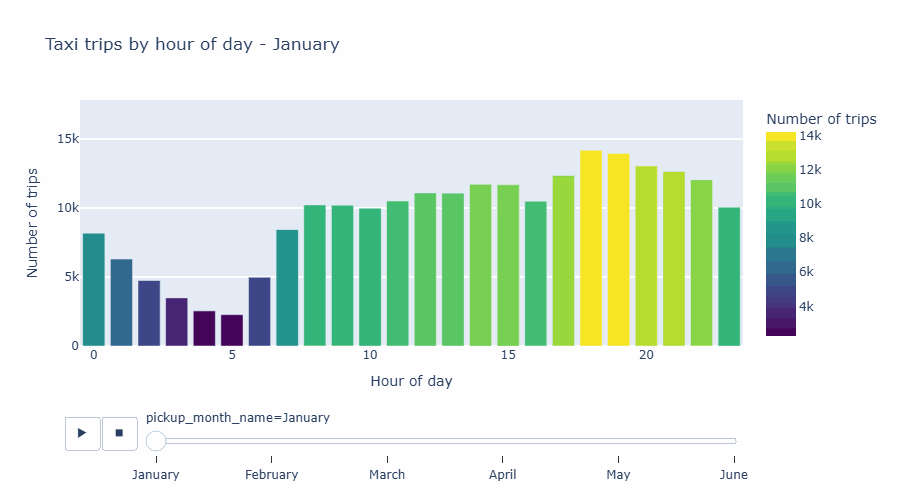

# NYC Taxi Data Analysis

Data preprocessing, NumPy and advanced visualization on the NYC Taxi Trip Duration dataset (over 1.4 million trips).

## Preview


## Interactive charts
Open these in your browser (GitHub Pages):

- [Pickup locations map](https://asadwazirdev.github.io/Advance_visualization_project/week_04_project/outputs/pickup_geo_map.html)
- [Pickup density heatmap](https://asadwazirdev.github.io/Advance_visualization_project/week_04_project/outputs/pickup_density_map.html)
- [Pickups hour by hour (animated map)](https://asadwazirdev.github.io/Advance_visualization_project/week_04_project/outputs/pickups_by_hour_map.html)
- [Trips by hour, month by month (animation)](https://asadwazirdev.github.io/Advance_visualization_project/week_04_project/outputs/trips_animation.html)
- [Passenger group, time of day and distance (sunburst)](https://asadwazirdev.github.io/Advance_visualization_project/week_04_project/outputs/passenger_time_distance_sunburst.html)
- [Scaling comparison](https://asadwazirdev.github.io/Advance_visualization_project/week_04_project/outputs/scaling_comparison.html)

If a link does not open, download the HTML file from the `outputs/` folder and open it in your browser.

## Results
The full written report with insights and recommendations is in [NYC_Taxi_Final_Report.md](NYC_Taxi_Final_Report.md).

## What this project does
1. Data loading
2. Data cleaning (missing values, duplicates, invalid trips)
3. Feature engineering (time features, Haversine distance, speed, categories)
4. Feature scaling (Min-Max, Standardization)
5. Feature encoding (Label, One-hot)
6. NumPy implementation (slicing, aggregation, math operations)
7. Interactive Plotly charts (geo map, density map, animations, sunburst) and a GIF
8. Processed dataset and an auto-generated final report

## Dataset
Download `train.csv` from Kaggle: https://www.kaggle.com/datasets/yasserh/nyc-taxi-trip-duration

Rename it to `NYC.csv` and put it in the same folder as the notebook. The file is large, so it is not included in this repository.

## Setup
```bash
pip install pandas numpy scikit-learn plotly kaleido imageio pillow matplotlib nbformat
```
To save the GIF with Plotly, run `plotly_get_chrome` once. If Chrome is missing, the notebook falls back to matplotlib.

## Run
Open `nyc_taxi_preprocessing_01.ipynb` and run all cells. Outputs are saved in the `outputs/` folder, and the report is written to `NYC_Taxi_Final_Report.md`.

## Files
- `nyc_taxi_preprocessing_01.ipynb` - main notebook
- `NYC_Taxi_Final_Report.md` - generated report with insights
- `nyc_taxi_processed_sample.csv` - 100,000-row sample of the processed data
- `outputs/` - charts, animations and GIF
